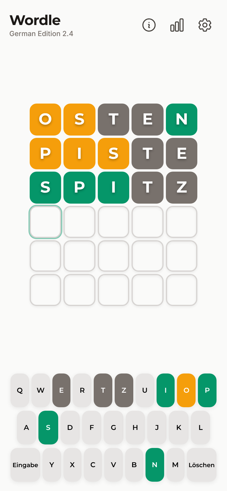
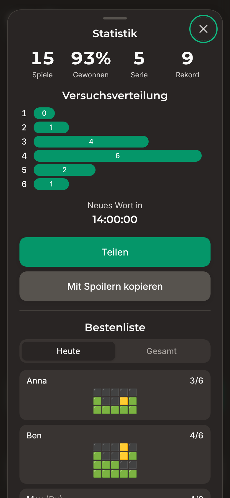
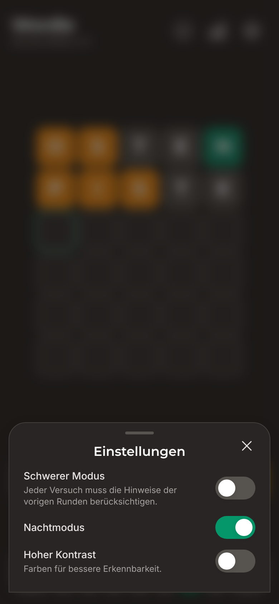

# Wordle

**German Edition 2.4**

[](https://github.com/matthabjan/wordle/actions/workflows/test.yml)
[](https://github.com/matthabjan/wordle/actions/workflows/lint.yml)
[](https://hub.docker.com/r/matthabjan/wordle)
[](LICENSE)

Wordle – German Edition is a daily word puzzle in the spirit of Wordle: guess the five-letter word in six tries. It's a self-hostable Progressive Web App (PWA) with no ads, no tracking and no accounts. Your progress stays on your device. An optional leaderboard, shared by passphrase, lets friends compare results.

<p align="center">
  
  &nbsp;
  
  &nbsp;
  
</p>

## Features

- **Curated German word lists**: 882 daily solutions and 2,340 accepted guesses. All entries are singular words written with A–Z only (no plurals, slang or English words).
- **Universal keyboard**: umlauts and ß are spelled out (`ä → ae`, `ß → ss`), so any keyboard works.
- **Edit with the cursor**: tap any letter in the current row to overwrite it.
- **Hard mode**: every guess must use the hints already revealed.
- **Dark mode and high contrast**: includes a colour-blind-friendly palette.
- **Statistics**: tracks streaks and the distribution of guesses per game, stored locally.
- **Sharing**: share via the system share sheet or the clipboard, with an optional spoiler version for friends.
- **Installable PWA**: works offline and feels native on iOS and Android home screens.
- **Optional leaderboard**: daily and all-time rankings for everyone who knows a shared passphrase. Grids only unlock once you've finished the word yourself, and the game is unaffected if the backend is down.

## Quick start

**Play locally** (Node.js 22+):

```bash
git clone https://github.com/matthabjan/wordle.git
cd wordle
npm install
npm run dev          # → http://localhost:5173
```

**Run with Docker** (prebuilt multi-arch images):

```bash
docker run -d -p 8080:8080 matthabjan/wordle:latest   # → http://localhost:8080
```

**With the leaderboard** (Docker Compose):

```bash
cp .env.docker.example .env.docker   # set LEADERBOARD_PASSPHRASE
make up-prod                          # app + leaderboard API → http://localhost:8080
```

## Documentation

| Guide | Contents |
|---|---|
| [Development](docs/development.md) | Setup, scripts, project structure, architecture, testing, CI, releases |
| [Word lists](docs/word-lists.md) | Rules for solutions and guesses, the daily calendar, how to edit the lists safely |
| [Leaderboard](docs/leaderboard.md) | How it works, scoring, API reference, configuration |
| [Deployment (Docker)](DOCKER.md) | Images, Compose, Traefik/Portainer, TLS, backups, troubleshooting |

## Tech stack

React 18, TypeScript (strict), Vite 6, Tailwind CSS 4, Headless UI, Framer Motion and `vite-plugin-pwa`. Tests use Vitest and Testing Library. The optional backend uses Fastify and SQLite (`better-sqlite3`). Production serves the static build with nginx.

## Contributing

Issues and pull requests are welcome. Before opening a PR:

```bash
npm run lint && npm test
(cd server && npm test)   # if you touched server/
```

UI copy stays in German (`src/constants/strings.ts`). Changes to the word lists must follow the [word-list rules](docs/word-lists.md#rules). See [Development](docs/development.md) for conventions.

## License & credits

[MIT](LICENSE). Forked from [woertchen](https://github.com/diondiondion/woertchen) by diondiondion. The original Wordle is by Josh Wardle.
