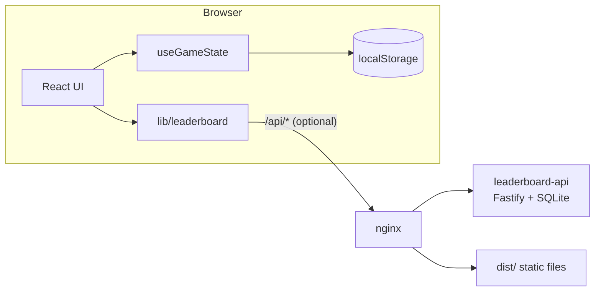

# Development

← [README](../README.md) · [Word lists](word-lists.md) · [Leaderboard](leaderboard.md) · [Deployment](../DOCKER.md)

## Prerequisites

- Node.js **22** (same as CI) and npm
- Optional: Docker with Compose v2, for production-like runs

## Setup

```bash
npm install
cp .env.example .env      # optional: sets VITE_GAME_NAME / VITE_GAME_DESCRIPTION
npm run dev               # http://localhost:5173
```

To work on the leaderboard at the same time, start the API in a second terminal. Vite proxies `/api` to it:

```bash
cd server
npm install               # server/ has its own package.json
LEADERBOARD_PASSPHRASE=devsecret npm start   # http://localhost:3001
```

### Environment variables (build time)

| Variable | Purpose | Default in `.env.example` |
|---|---|---|
| `VITE_GAME_NAME` | Title in the header, share text and document title | `Wordle` |
| `VITE_GAME_DESCRIPTION` | Meta description | `Wordle auf Deutsch` |

These values are baked into the static bundle at build time. Runtime settings for the leaderboard are listed in [Leaderboard → Configuration](leaderboard.md#configuration).

## Scripts

| Command | What it does |
|---|---|
| `npm run dev` / `npm start` | Vite dev server with hot reload |
| `npm run build` | Type-check (`tsc --noEmit`), then production build to `dist/` |
| `npm run preview` | Serve the production build locally |
| `npm test` | Run Vitest once |
| `npm run test:watch` | Vitest in watch mode |
| `npm run lint` | Prettier check of `src/` |
| `npm run fix` | Prettier write of `src/` |
| `npm run release:{patch,minor,major}` | Bump the version in both `package.json` files, commit and tag (see [Releasing](#releasing)) |
| `cd server && npm test` | Leaderboard API tests (`node --test`) |

Docker shortcuts are in the `Makefile` (`make help`). The most useful are `make up-prod`, `make logs-prod`, `make health` and `make down-prod`.

## Project structure

```
wordle/
├── src/
│   ├── App.tsx              # Layout, modals, leaderboard submission
│   ├── components/
│   │   ├── alerts/          # Toast notifications
│   │   ├── grid/            # Board, rows, cells (cursor editing)
│   │   ├── keyboard/        # On-screen keyboard with key statuses
│   │   ├── modals/          # Info, Settings, Stats (Headless UI)
│   │   └── stats/           # Histogram, stat bar, Leaderboard
│   ├── constants/
│   │   ├── settings.ts      # MAX_WORD_LENGTH, MAX_CHALLENGES, timings
│   │   ├── strings.ts       # All German UI copy
│   │   ├── wordlist.ts      # Daily solutions (order = calendar)
│   │   └── validGuesses.ts  # Additional accepted guesses
│   ├── context/             # Alert context
│   ├── hooks/               # useGameState, useTheme, useWordOfDay
│   └── lib/                 # words, statuses, stats, share, leaderboard, localStorage, haptics
├── server/                  # Optional Fastify + SQLite leaderboard API
├── docker/                  # nginx config for the production image
├── public/                  # PWA icons, manifest, self-hosted fonts
└── docs/                    # This documentation + screenshots
```

## Architecture

The game is a client-only single-page app. No server is needed to play.



- **Daily word**: `getWordOfDay()` in `src/lib/words.ts` counts the days since `GAME_EPOCH` (9 February 2026, local midnight) and picks `WORDS[index % WORDS.length]`. Everyone gets the same word on the same local date. `useWordOfDay` switches to the next word at midnight without a reload.
- **Guess validation**: a guess is accepted if it is in `WORDS` or `VALID_GUESSES`, compared case-insensitively. Hard mode is enforced by `findFirstUnusedReveal`.
- **Statuses**: `src/lib/statuses.ts` computes correct/present/absent per letter and handles duplicate letters the same way as the original Wordle.
- **Persistence**: everything lives in `localStorage`. These keys are a compatibility contract with existing players, so only add new keys and migrate deliberately.

  | Key | Content |
  |---|---|
  | `gameState` | `{ guesses, solution }` for the current day |
  | `gameStats` | Win distribution, streaks, totals, last played index |
  | `theme`, `highContrast`, `gameMode` | Settings |
  | `leaderboardName`, `leaderboardPassphrase` | Optional leaderboard identity |

- **Leaderboard**: submitted automatically when a game ends. Errors are swallowed so the game never blocks on it. See [Leaderboard](leaderboard.md).
- **PWA**: `vite-plugin-pwa` generates the service worker. The app shows a prompt when an update is available (`virtual:pwa-register`).

## Conventions

- **Language**: UI strings are German and live in `src/constants/strings.ts`.
- **Characters**: A–Z only. Words are stored in lowercase; umlauts and ß are written out.
- **Components**: functional React components styled with Tailwind, Headless UI for modals and Heroicons for icons. Use relative imports.
- **Types**: TypeScript `strict: true`. Don't loosen `tsconfig.json`.
- **Timing**: derive animation delays from `REVEAL_TIME_MS` instead of hard-coding them.
- **Formatting**: Prettier, with imports sorted by `@trivago/prettier-plugin-sort-imports`. Run `npm run fix` before committing.

## Testing

Unit and component tests sit next to the code (`*.test.ts(x)`) and run on Vitest with jsdom and Testing Library. The server has its own tests in `server/index.test.js`.

```bash
npm test                  # app
(cd server && npm test)   # API
```

When you change game logic or UI, run `npm run lint` and `npm test` before pushing.

## CI

GitHub Actions run on pushes to `main` and `development`, and on pull requests:

| Workflow | Checks |
|---|---|
| `lint.yml` | `npm run lint` |
| `test.yml` | App tests, server tests, and that `server/package.json` has the same version as `package.json` |
| `docker.yml` | Builds and publishes both images to Docker Hub (`development` → `:dev`, `main` → `:edge`, tag `vX.Y.Z` → semver tags, `:latest` and a GitHub Release) |

Dependabot opens PRs against `development` and ignores major version bumps.

## Releasing

Versions follow SemVer and are taken from the root `package.json`. `server/package.json` always has the same version.

```bash
git checkout main
npm run release:patch     # or release:minor / release:major
git push --follow-tags    # tag vX.Y.Z triggers the Docker release
```

The `release:*` scripts keep both versions in sync. The tag must be `v` followed by the `package.json` version.
